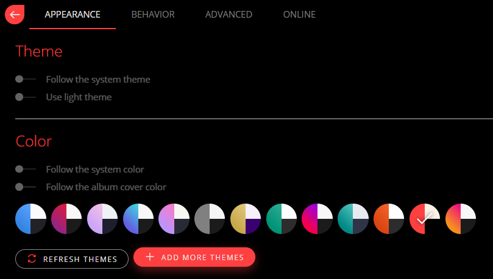

# Installing Theme

To install the theme:
- Open Dopamine 3
- Open the $${\color{blue}Menu}$$
- Open <mark>Settings</mark>
- Under the section **Colors**, press $${\color{blue}Add \space More \space Themes}$$
- Copy the theme file into the directory (folder) that opened up

May have to restart Dopamine 3.

